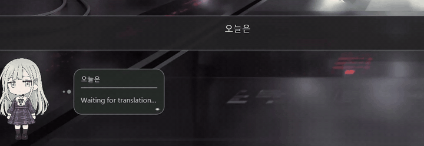
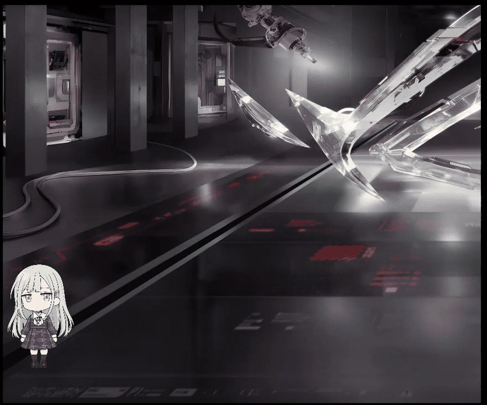
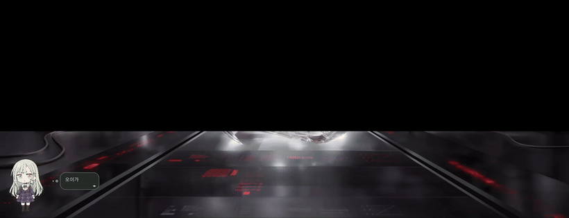
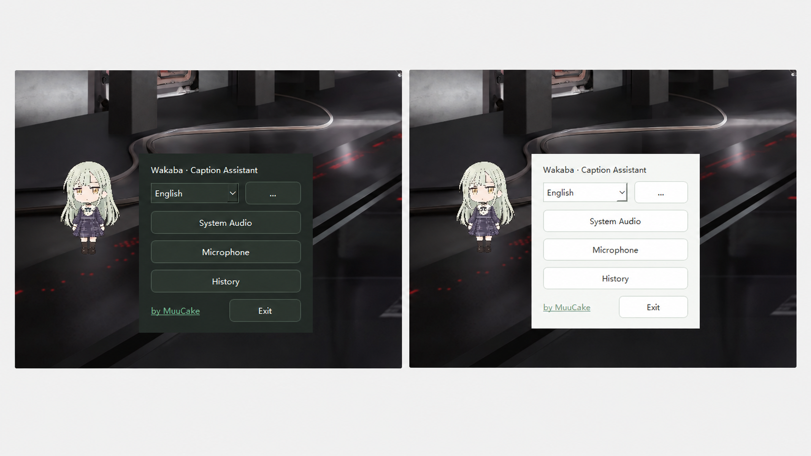

# LiveCaptions Translator Buddy

**Real-time captions, live translation, and TXT recording — with a cute anime desktop companion.**

Capture speech, translate subtitles, and save bilingual transcripts — all in one place.

### Live Translation in Action

### [Download for Windows (x64)](https://github.com/MuuCake/LiveCaptions-Translator-Buddy/releases/latest)

**Latest Version: v1.5.0**

Download the Windows ZIP, extract all files, and run `LiveCaptionV1.5.0.exe`.

**Keep the `_internal` folder together with the EXE. No Python installation required.**

---

## Features

### Real-Time Captions & Translation

- Capture speech using Windows 11 Live Captions.
- Support for **System Audio** and **Microphone** input modes.
- Choose between **Google Translate** and **Tencent TranSmart**.
- Incremental translation updates as captions are recognized.
- Original, translated, and bilingual subtitle previews.
- Save original text, translations, or bilingual transcripts to TXT.

### TXT Recording & History

- Custom TXT filenames and save folders.
- Optional timestamps for recorded captions.
- Pause, resume, stop, and save recordings.
- Automatic backups and recovery after unexpected interruptions.
- SQLite-based recording history.
- Search, view, and manage saved recordings.
- Built-in TXT reader for reviewing transcripts.

### Anime Desktop Companion

- Interactive Wakaba Mutsumi desktop pet.
- Transparent background with blinking, breathing, and idle animations.
- Click interactions and draggable positioning.
- Adjustable pet size.
- Floating subtitle bubbles beside the character.
- Original, translated, and bilingual bubble display.
- Automatic, left-side, and right-side bubble positioning.

### Interface & Customization

- **12 UI languages** available.
- Windows light and dark theme support.
- Customizable translation, recording, and appearance settings.
- Standalone Windows x64 application.

---

## Screenshots & Demos

### Main Interface & Translation Settings

A simple interface for choosing audio modes, translation services, and language preferences.

### Desktop Pet Customization

Move your desktop companion, adjust its size, and choose where subtitle bubbles appear.

### Light & Dark Mode

Choose the appearance that fits your desktop. The interface supports both Windows light and dark themes.

---

## Quick Start

1. Download the latest Windows x64 ZIP from [Releases](https://github.com/MuuCake/LiveCaptions-Translator-Buddy/releases/latest).
2. Extract the entire ZIP file to a folder.
3. Keep `LiveCaptionV1.5.0.exe` and the `_internal` folder together.
4. Run `LiveCaptionV1.5.0.exe`.
5. Select your preferred UI language.
6. Choose **System Audio** or **Microphone**.
7. Configure translation and recording options as needed.
8. Start capturing captions and save your transcripts when finished.

You can also open **History** to review previously saved recordings.

---

## Requirements

| Requirement | Details |
|---|---|
| Operating System | Windows 11 (64-bit) |
| Speech Recognition | Windows Live Captions |
| Internet Connection | Required for online translation |
| Python | Not required for the packaged EXE |

**Important Notes:**

- Speech recognition is provided by Windows Live Captions.
- Available recognition languages depend on Windows Live Captions and your system configuration.
- Translation quality and response time depend on the selected service and network conditions.
- Keep all extracted files together when running the application.

---

## Supported UI Languages

LiveCaptions Translator Buddy supports **12 interface languages**.

You can change the UI language from the application's language selector.

**Note:** UI languages and speech recognition languages are different. The 12 UI languages do not indicate that Windows Live Captions supports exactly 12 recognition languages.

---

## FAQ

### Do I need to install Python?

No. The packaged Windows application includes its required runtime components.

### Can I download only the EXE?

No. The v1.5.0 release uses a multi-file distribution. Download and extract the complete Windows ZIP, including the `_internal` folder.

### Does translation require an internet connection?

Yes. Google Translate and Tencent TranSmart are online translation services. Translation performance depends on network availability and the selected provider.

### Can I save bilingual transcripts?

Yes. You can save original captions, translated text, or bilingual transcripts in TXT format.

### Can I review previous recordings?

Yes. The application includes recording history, search, and a built-in TXT reader.

### Does the application support different Windows themes?

Yes. It supports Windows light and dark themes.

### Why does Windows show a security warning?

The application is not currently code-signed. Windows may display a security warning when launching the downloaded application. Please verify the download source before running it.

---

## Credits

**Created by [MuuCake](https://github.com/MuuCake)**

Built using Python, PySide6, and Windows Live Captions integration.

Translation services:
- Google Translate
- Tencent TranSmart

Desktop companion:
- Wakaba Mutsumi, from *BanG Dream! Ave Mujica*

This is an independent, unofficial project. It is not affiliated with or endorsed by Microsoft, Google, Tencent, or the rights holders of *BanG Dream! Ave Mujica*.

All third-party names, characters, artwork, and trademarks belong to their respective owners.

---

## License & Third-Party Notices

The **v1.5.0 application** is distributed as a prebuilt Windows executable package. Its application source code is not publicly released.

This repository also contains source code from earlier versions, published under the MIT License. See [LICENSE](LICENSE) for the repository's existing license text.

The MIT License for earlier source code does not automatically grant rights to third-party characters, artwork, trademarks, or other external assets.

Third-party libraries and components, including PySide6/Qt, remain subject to their respective license terms.

Please do not assume that the v1.5.0 application is a fully open-source release.

---

**Made with care by [MuuCake](https://github.com/MuuCake)**

If you find this project useful, consider giving it a star!

[Download Latest Release](https://github.com/MuuCake/LiveCaptions-Translator-Buddy/releases/latest)

