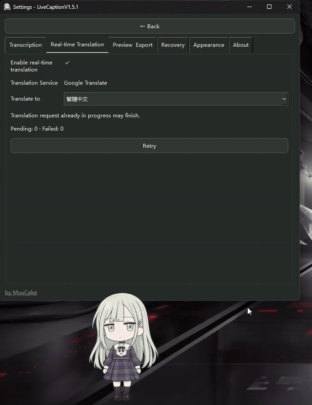
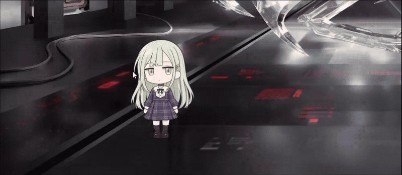
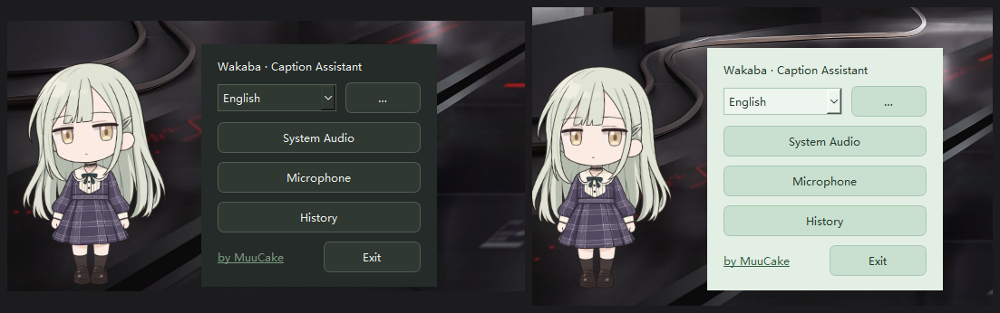

୨୧ ───── ฅ^•ﻌ•^ฅ ───── ୨୧

# LiveCaptions Translator Buddy

**Real-time captions, live translation, and TXT recording — with a cute anime desktop companion.**

Capture, translate, and save subtitles on Windows 11, accompanied by Wakaba Mutsumi! ♡

### Live Translation in Action

### [Download for Windows (x64)](https://github.com/MuuCake/LiveCaptions-Translator-Buddy/releases/latest)

Download the **Windows x64 ZIP**, extract all files, and run `LiveCaptionV1.5.1.exe`. Keep the `_internal` folder. No Python installation required.

**繁體中文：** 下載最新的 **Windows x64 ZIP 壓縮檔**，完整解壓縮並保留 `_internal` 資料夾，再執行 `LiveCaptionV1.5.1.exe`，無須安裝 Python。

୨୧ ───── ฅ^•ﻌ•^ฅ ───── ୨୧

---

## Features

### Real-Time Captions & Translation
- **System Audio & Microphone** modes powered by Windows 11 Live Captions.
- Online translation with **Google Translate**.
- Live subtitle updates with **Original / Translated / Bilingual** preview modes.
- TXT export with optional timestamps and custom save locations.

### Recording & History
- Pause, resume, and save recordings.
- Automatic backup and recovery.
- Searchable SQLite history with a built-in TXT reader.
- Long-press multi-selection and batch deletion.

### Wakaba Mutsumi Desktop Pet
- Blinking, breathing, and sleepy animations.
- Pick up, drag, and release Wakaba to watch her fall and stand back up!
- Adjustable character size and subtitle bubble positioning.
- Supports Windows light and dark themes.

### Multilingual Interface
- **12 UI languages**, with English as the default.
- Customizable recording, translation, and appearance settings.

---

## Screenshots & Demos

### Translation Settings

Customize Google Translate and your subtitle preferences.

### Desktop Pet Interaction

Pick up Wakaba, move her around, and watch her adorable falling animations! ฅ^•ﻌ•^ฅ

### Light & Dark Mode

Automatically follows your Windows appearance settings.

---

## Supported UI Languages

| | |
|---|---|
| English | Português (Brasil) |
| 한국어 | Bahasa Indonesia |
| 简体中文 | Deutsch |
| 繁體中文 | Türkçe |
| 日本語 | Français |
| Español | Русский |

**Note:** UI language settings do not change speech recognition languages. Speech recognition is provided by Windows Live Captions.

---

## Quick Start

1. Download the latest ZIP from [Releases](https://github.com/MuuCake/LiveCaptions-Translator-Buddy/releases/latest).
2. Extract it and run `LiveCaptionV1.5.1.exe`.
3. Choose **System Audio** or **Microphone**.
4. Customize your settings and start recording!

Access saved transcripts through **History**.

---

## Requirements & Notes

- **OS:** Windows 11 (64-bit).
- **Speech Recognition:** Windows Live Captions.
- **Translation:** Google Translate (internet required; availability depends on your network).
- **Python:** Not required.
- **Security:** This application is currently unsigned. Windows security features may warn about or block the EXE. Verify the source before running it.

---

## Credits & License

Created by **[MuuCake](https://github.com/MuuCake)**.

Built with Python, PySide6/Qt, and Windows Live Captions.

Desktop companion: Wakaba Mutsumi from *BanG Dream! Ave Mujica*.

This is an unofficial fan project and is not affiliated with Microsoft, Google, or the rights holders of *BanG Dream! Ave Mujica*.

**License:** Publicly available source files in this repository are covered by the [MIT License](LICENSE). The v1.5.1 application is distributed as a compiled Windows package; its full application source is not included in this release. Third-party libraries, artwork, characters, and trademarks remain subject to their respective rights and licenses.

---

୨୧ ───── ฅ^•ﻌ•^ฅ ───── ୨୧

**Made with ♡ by [MuuCake](https://github.com/MuuCake)**

[Download Latest Release](https://github.com/MuuCake/LiveCaptions-Translator-Buddy/releases/latest)

